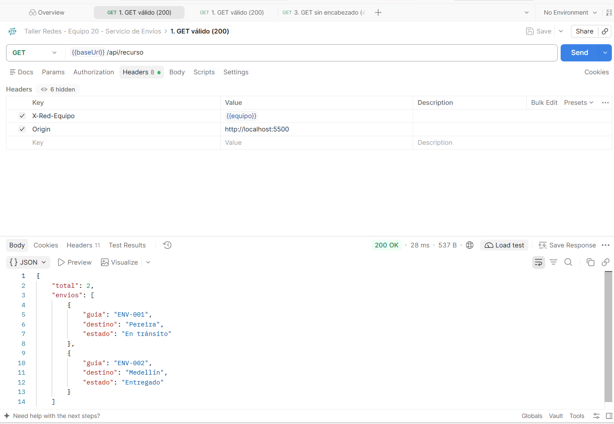

# Servicio de Consulta de Estado de Envíos

Taller final – Programación de Redes · CIAF · Grupo 2 (miércoles)

## Integrantes (orden alfabético por apellido)

| N.º de lista | Nombre completo |
|---|---|
| 20 | Rendon Jaramillo Wilder Andres |
| 21 | Restrepo Velez Katherine |

- **Valor de N:** 20 (número de lista del primer integrante en orden alfabético)
- **Encabezado asignado:** `X-Red-Equipo: CIAF-20`
- **Encabezado de respuesta:** `X-Servidor-Procesado: Equipo-20`

## Escenario

Una empresa de mensajería necesita un servicio para que sus clientes **consulten el estado de sus envíos** y para que las sucursales **registren envíos nuevos**.

- **Cliente que lo consume:** una página web (navegador) del portal de clientes, servida desde `http://localhost:5500`, y los sistemas internos de las sucursales.
- **Riesgos si viajara por HTTP sin cifrar:** cualquiera en la misma red (por ejemplo, un Wi-Fi público) podría leer los números de guía, direcciones y datos de los clientes; podría robar el encabezado `X-Red-Equipo` y usarlo para hacerse pasar por el cliente; o podría modificar la respuesta en el camino (ataque de intermediario) y mostrar un estado falso del envío.

## Cómo ejecutar

```bash
npm install
npm start
```

El servidor queda en `http://localhost:3000`.

| Método | Ruta | Descripción | Respuesta |
|---|---|---|---|
| GET | `/api/recurso` | Lista los envíos | 200 |
| POST | `/api/recurso` | Registra un envío (`{ "guia", "destino", "estado" }`) | 201 / 400 |

Toda petición sin `X-Red-Equipo: CIAF-20` responde **401 Unauthorized** con un JSON explicativo.

## CORS

El servidor usa el middleware `cors` y solo permite el origen `http://localhost:5500`. Cuando la petición llega desde ese origen, el servidor devuelve:

```
Access-Control-Allow-Origin: http://localhost:5500
```

**Qué problema resuelve CORS:** por seguridad, el navegador no deja que una página de un origen (dominio + puerto) lea respuestas de otro origen. CORS permite que nuestro servidor diga explícitamente qué orígenes sí pueden leer sus respuestas. Así, el portal de clientes en `localhost:5500` puede consumir la API, pero una página maliciosa de otro dominio no puede leer los datos de los envíos desde el navegador de un usuario. CORS lo aplica el navegador; Postman no lo aplica, por eso en Postman la petición funciona aunque no se envíe `Origin`.

## Viaje de la petición en el modelo TCP/IP

| Capa | Qué pasa en nuestra petición |
|---|---|
| **Aplicación** | Postman arma el mensaje HTTP: método (`GET`/`POST`), ruta `/api/recurso`, encabezados (`X-Red-Equipo`, `Content-Type`) y el cuerpo JSON. Express lo interpreta, el middleware valida el encabezado y responde. |
| **Transporte** | El mensaje viaja en un segmento **TCP**. Se hace el *handshake* de 3 vías (SYN, SYN-ACK, ACK), el puerto de origen es uno aleatorio y el de destino es **3000**. TCP garantiza que los datos lleguen completos y en orden. |
| **Internet** | El segmento se mete en un paquete **IP** con dirección origen y destino `127.0.0.1` (localhost). En un despliegue real serían las IP del cliente y del servidor y los routers decidirían la ruta. |
| **Acceso a red** | El paquete se convierte en tramas y bits. En localhost usa la interfaz de *loopback*; en una red real sería Ethernet o Wi-Fi con direcciones MAC. |

En el servidor el proceso es al revés: se sube de capa en capa hasta que Express recibe la petición HTTP.

## Qué protege SSL/TLS (HTTPS)

TLS trabaja entre la capa de Aplicación y la de Transporte y cifra todo el mensaje HTTP. En nuestro caso protege:

- **Confidencialidad:** nadie en la red puede leer los encabezados (incluido `X-Red-Equipo`) ni los datos de los envíos.
- **Integridad:** nadie puede modificar la petición o la respuesta sin que se detecte.
- **Autenticidad:** el certificado del servidor demuestra que el cliente habla con el servidor real de la empresa y no con un impostor.

Sin HTTPS, nuestro encabezado de "credencial" viaja en texto plano y cualquiera que lo capture puede reutilizarlo.

## Pruebas en Postman

La colección exportada está en `coleccion-postman.json` (importar en Postman → *Import*).

1. GET válido → 200
2. POST válido → 201
3. GET sin encabezado → 401
4. POST con encabezado incorrecto → 401
5. Verificación de encabezados de respuesta (tests automáticos)

### Capturas

**Respuesta exitosa con encabezados visibles:**



**Respuesta 401 al omitir el encabezado:**


